<div align="center">

# Surface Defect Inspection with Deep Learning

**A camera image of hot-rolled steel goes in. Out come the defect type, a heatmap of where the defect is, and an ACCEPT / REJECT / MANUAL REVIEW decision, much like an inline Cognex or Keyence vision station.**

[](https://www.python.org/)
[](https://pytorch.org/)
[](https://streamlit.io/)
[-ff8a3d?style=for-the-badge&labelColor=0b0c0f)](#results)
[](#tests)
[](LICENSE)

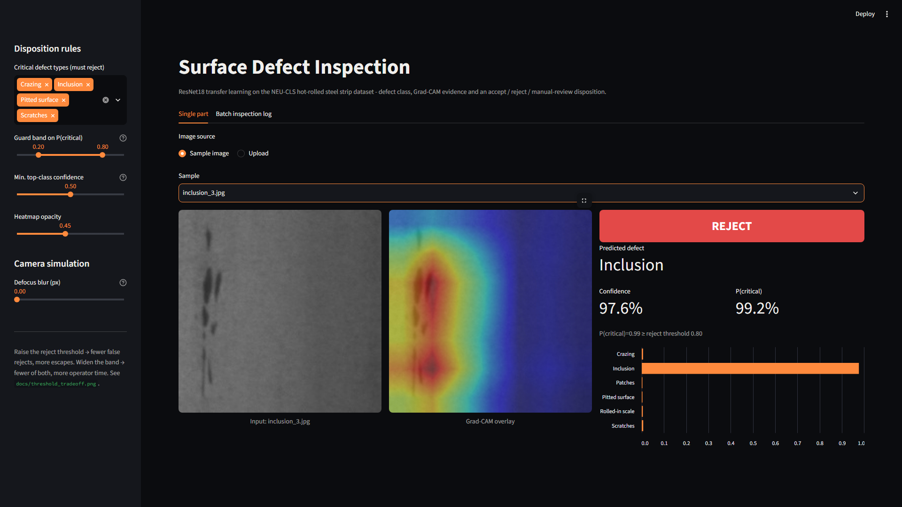

</div>

---

## Why this project

I calibrated Cognex and Keyence vision systems on SMT lines at Mylan, which raised inspection accuracy by 15% and removed more than 300 false rejects a month. In undergrad I built an AI conveyor that inspected gears, with a defect detection rate above 90%. This project rebuilds that kind of inspection station from scratch with deep learning. It also asks the questions a quality engineer would ask, not just "what is the accuracy?":

* **What did the model look at?** A Grad-CAM heatmap comes with every decision.
* **What does a wrong call cost?** The project plots the **escape rate** (critical defects shipped) against the **false-reject rate** (acceptable product scrapped) as the reject threshold moves.
* **What happens when the camera drifts?** I stress-tested the model with defocus and lighting changes, found that it was fragile, and fixed it.

## Results

Measured on a held-out, class-stratified **test set of 270 images** (45 per class, seed 42) that the model never saw during training or early stopping.

| Metric | Value |
|---|---|
| Test accuracy | **100.0%** (270 / 270) |
| Macro precision / recall / F1 | **1.000 / 1.000 / 1.000** |
| Training time | 1.3 min, 18 epochs (early stop, best epoch 12), RTX 4060 Laptop GPU |
| Model size | 22 MB (ResNet18, fp16 weights committed in `models/`) |
| Accuracy under 1 px defocus: **without** vs **with** blur augmentation | 57.4% → **100.0%** |
| Accuracy under 2 px / 3 px defocus (shipped model) | 99.6% / 85.2% |
| Accuracy under ±40% lighting gain | 99.3–100% |
| **3 px-defocused camera**, single pass/fail gate at t = 0.50 | escape rate **16.1%**, false-reject rate 0.0% |
| **3 px-defocused camera**, guard band 0.20–0.80 | escape rate **7.2%**, false-reject rate 0.0%, **9.6%** sent to manual review |

| Class | Precision | Recall | F1 | Support |
|---|---|---|---|---|
| Crazing | 1.000 | 1.000 | 1.000 | 45 |
| Inclusion | 1.000 | 1.000 | 1.000 | 45 |
| Patches | 1.000 | 1.000 | 1.000 | 45 |
| Pitted surface | 1.000 | 1.000 | 1.000 | 45 |
| Rolled-in scale | 1.000 | 1.000 | 1.000 | 45 |
| Scratches | 1.000 | 1.000 | 1.000 | 45 |

> **An honest note:** NEU-CLS is a clean, well-lit benchmark, and published CNNs commonly score 99–100% on it, so a perfect score on clean images is expected rather than remarkable. The more useful engineering result is the robustness work. The first model scored 100% on clean images but fell to **57%** with a single pixel of defocus blur. Adding defocus augmentation during training brought that back to **100%**. When the camera is badly out of focus (3 px), the guard band roughly **halves escapes** (16.1% → 7.2%), at the cost of routing about 1 in 10 parts to an operator. Every number above is in [`reports/metrics.json`](reports/metrics.json), and the pre-augmentation baseline is in [`reports/metrics_baseline_no_blur_aug.json`](reports/metrics_baseline_no_blur_aug.json).

## How it works, in plain words

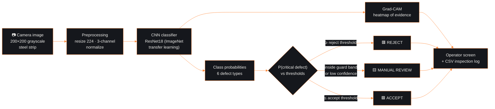

1. **Camera image in.** Each NEU image is a 200×200 grayscale photo of a hot-rolled steel strip. The dataset has six defect types (shown below).
2. **Preprocessing.** The image is resized to 224×224 and copied into three channels, then scaled the same way as the ImageNet photos the network was first trained on.
3. **CNN classifier.** ResNet18 is a convolutional network already trained on 1.2 million everyday photos, so it already detects edges, spots and textures. I replaced its final layer with a 6-class "defect type" layer and **fine-tuned** it on 1,260 steel images. This is *transfer learning*: it needs far less data and time than training from scratch. Augmentation (random flips, crops, brightness/contrast changes and **defocus blur**) shows the model the variation a real line produces. **Early stopping** saves the epoch with the best validation loss and stops once it stops improving.
4. **Grad-CAM.** Grad-CAM traces the prediction back through the last convolutional block to produce a heatmap of the pixels that mattered most. If the heat sits on the scratch, the model has learned the right cue. If it sits on the background, that is a warning sign.
5. **Disposition.** The customer spec says which defect types are **critical** (default: crazing, inclusion, pitted surface, scratches) and which are **minor** (patches, rolled-in scale). The model's probabilities for the critical classes are added up into **P(critical)**, and two thresholds decide the outcome:
   * P(critical) ≥ *reject threshold* → **REJECT**
   * P(critical) ≤ *accept threshold* → **ACCEPT**
   * anything in between, or top-class confidence below a floor → **MANUAL REVIEW**

> NEU-CLS contains only defective samples, so "ACCEPT" here means "only a minor, spec-allowed defect is present". On a real line you would add a "good" class, or an anomaly score, to the same decision layer. The threshold logic stays the same.

## Figures

### The six defect classes
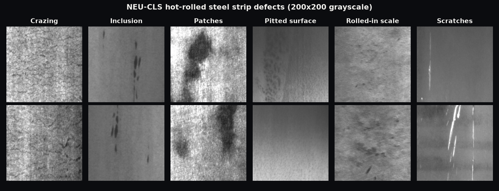

### Training curves
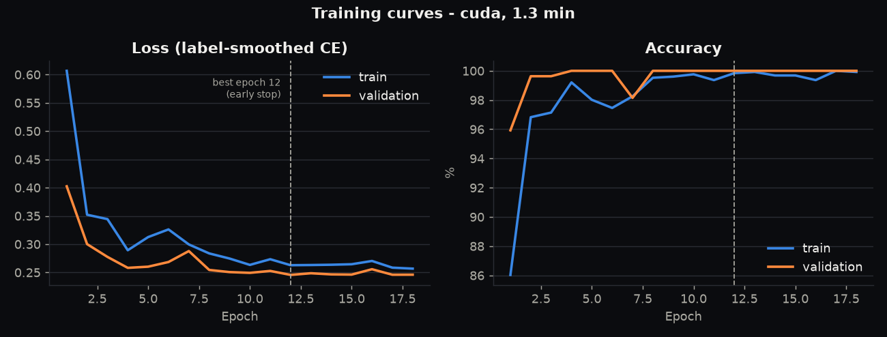

### Confusion matrix: clean images vs a degraded camera
On clean images every prediction is on the diagonal. With a 3 px blur, crazing is most often confused with rolled-in scale. Crazing is critical and rolled-in scale is minor, so that confusion produces an **escape**. This is exactly the kind of failure the guard band is designed to catch.
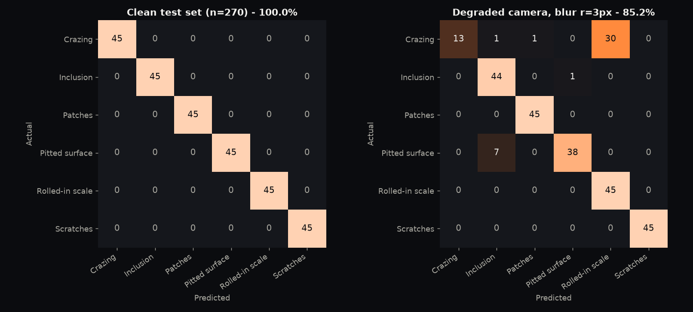

### Grad-CAM: where the model looks
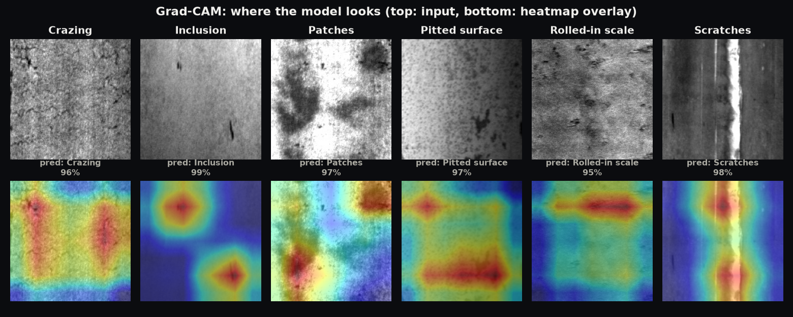

### Escape rate vs false-reject rate
Moving the single reject threshold to the left catches more critical defects but scraps more acceptable parts. Moving it to the right does the reverse. This is the same trade-off I tuned on vision stations to remove 300+ false rejects a month.
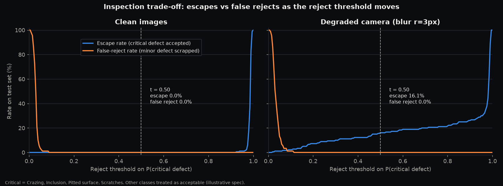

### Robustness to camera drift
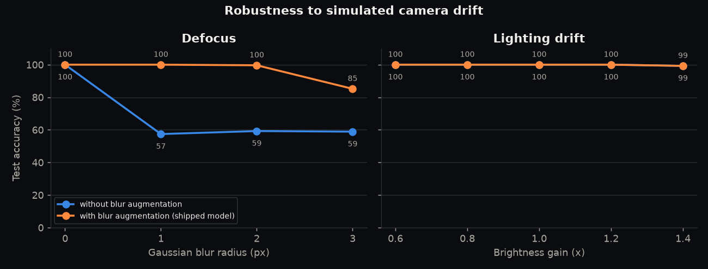

### The app
| Accept (minor defect) | Manual review (simulated 3 px defocus) |
|---|---|
| 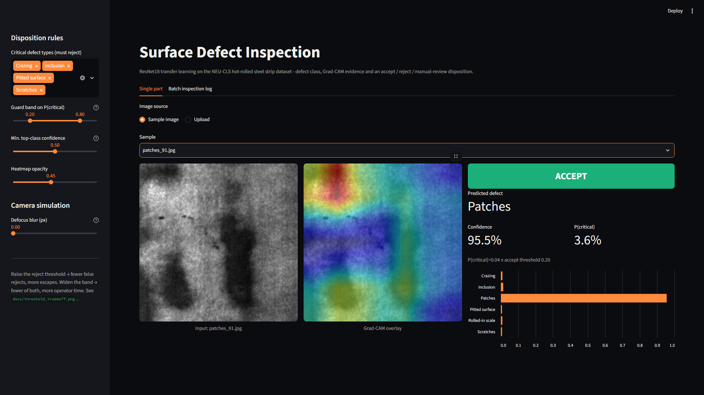 | 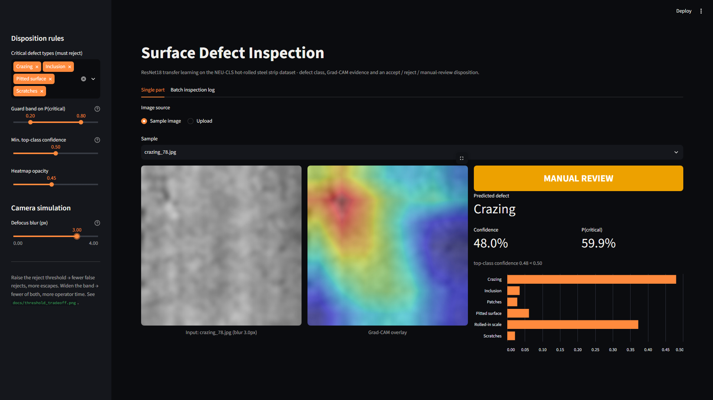 |

Batch mode inspects a whole folder or upload and produces a downloadable CSV inspection log:
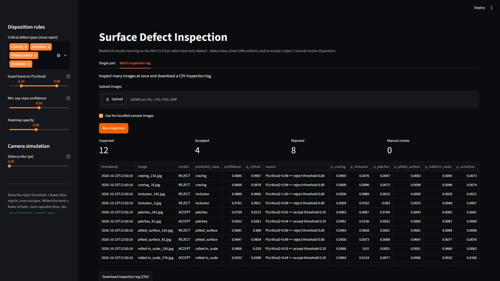

## Mapping to an inline Cognex / Keyence station

| Inline vision station | This project |
|---|---|
| Camera + lighting + lens | NEU images; lighting jitter and defocus augmentation; robustness test |
| Inspection tool (blob, pattern, or deep-learning classifier such as Cognex ViDi / Keyence AI) | Fine-tuned ResNet18 |
| Tool graphics overlay on the HMI | Grad-CAM heatmap |
| Pass/fail tolerance, reject window | `accept` / `reject` thresholds on P(critical) |
| "Recheck" / divert-to-operator lane | MANUAL REVIEW guard band and low-confidence rule |
| Defect classification → disposition per customer spec / MRB | Configurable critical-class list |
| Results logging to MES / SPC | Batch CSV inspection log (timestamp, verdict, class, probabilities, reason) |
| Gauge R&R, false-reject tuning | Escape vs false-reject curve; per-class precision and recall |
| Periodic recalibration (focus, illumination) | Defocus study: why focus drift must be controlled |

## Run it yourself (Windows, step by step)

You need **Python 3.10–3.12** and **git**. An NVIDIA GPU is optional. Everything also runs on CPU (training is then about 10–20 min instead of about 1.5 min).

**1. Clone the repo**
```powershell
git clone https://github.com/PiyushBhamare2111/surface-defect-inspection.git
cd surface-defect-inspection
```

**2. Create and activate a virtual environment**
```powershell
py -3.12 -m venv .venv
# (or: & "$env:LOCALAPPDATA\Programs\Python\Python312\python.exe" -m venv .venv)
.\.venv\Scripts\Activate.ps1
```
If PowerShell blocks the activation script, run `Set-ExecutionPolicy -Scope CurrentUser RemoteSigned` once, then activate again. In `cmd.exe`, use `.venv\Scripts\activate.bat`.

**3. (Optional, NVIDIA GPU) Install CUDA-enabled PyTorch first**
```powershell
python -m pip install --upgrade pip
pip install torch==2.5.1 torchvision==0.20.1 --index-url https://download.pytorch.org/whl/cu124
```

**4. Install the requirements**
```powershell
pip install -r requirements.txt
python -c "import torch; print(torch.__version__, 'CUDA:', torch.cuda.is_available())"
```

**5. Download the dataset** (27 MB, no login; the script checks the MD5 and extracts only images into `data/NEU-CLS/`)
```powershell
python scripts/download_data.py
```

**6. Train** (optional: trained weights are already in `models/resnet18_neu.pt`)
```powershell
python -m defect_inspect.train          # --epochs 30 --patience 6 --batch-size 32
```

**7. Evaluate** (prints metrics, writes `reports/metrics.json` and every figure in `docs/`)
```powershell
python -m defect_inspect.evaluate
```

**8. Launch the inspection app**
```powershell
streamlit run app.py
```
Then open **http://localhost:8501** in your browser. Press `Ctrl+C` in the terminal to stop it. The app runs from the committed weights and the 12 bundled sample images, so steps 5–7 are not needed just to try it.

**Extras**
```powershell
python scripts/inspect_folder.py samples --out reports/inspection_log.csv   # batch CSV from the CLI
python scripts/make_media.py                                                 # 1920x1080 showcase slides
pip install playwright==1.64.1; python -m playwright install chromium
python scripts/take_screenshots.py                                           # app screenshots (app must be running)
```

## Tests

```powershell
python -m pytest -q
```
15 tests cover the following: the split is stratified, disjoint and deterministic; the filename-to-label mapping is correct; preprocessing gives the right shape and normalization for grayscale and RGB input; the forward-pass shape is correct; fp16 checkpoints round-trip; one training step updates the weights; Grad-CAM output has the right shape and range; accept/reject/review thresholds behave correctly at the boundaries, including low-confidence and invalid input; the trade-off curve is monotonic; the trained model is correct on all bundled samples; and a Streamlit `AppTest` runs the single-part and batch flows without exceptions.

## Project structure

```
surface-defect-inspection/
├── app.py                      # Streamlit inspection station (single part + batch CSV log)
├── defect_inspect/             # the Python package
│   ├── config.py               # classes, paths, default critical-defect spec
│   ├── data.py                 # discovery, stratified split, transforms, Dataset
│   ├── model.py                # ResNet18 build / save (fp16) / load
│   ├── train.py                # fine-tuning loop, AMP, early stopping
│   ├── evaluate.py             # metrics, confusion matrix, trade-off, robustness, figures
│   ├── gradcam.py              # Grad-CAM + heatmap overlay
│   ├── decision.py             # accept / reject / review logic, escape vs false-reject curve
│   └── inference.py            # Inspector API used by app and CLI
├── scripts/
│   ├── download_data.py        # fetch + MD5-verify + safely extract NEU-CLS
│   ├── make_samples.py         # copy 2 test images per class to samples/
│   ├── inspect_folder.py       # batch inspection -> CSV
│   ├── make_media.py           # 1920x1080 showcase slides -> docs/media/
│   └── take_screenshots.py     # Playwright screenshots of the running app
├── models/                     # resnet18_neu.pt (22 MB), split.json, train_history.json
├── reports/                    # metrics.json, baseline metrics, evaluation log
├── samples/                    # 12 demo images (CC BY 4.0, see ATTRIBUTION.md)
├── docs/                       # README figures; docs/media/ = 1920x1080 slides & screenshots
├── tests/                      # pytest suite
└── requirements.txt
```

## Dataset and citation

**NEU Surface Defect Database (NEU-CLS):** 1,800 grayscale 200×200 images, 300 for each of six defect types on hot-rolled steel strip. Collected by the Surface Inspection Laboratory, **Northeastern University (Shenyang, China)**.

> K. Song and Y. Yan, "A noise robust method based on completed local binary patterns for hot-rolled steel strip surface defects," *Applied Surface Science*, vol. 285, pp. 858–864, 2013. doi:10.1016/j.apsusc.2013.09.002

The download mirror used here is [figshare, doi:10.6084/m9.figshare.28903550.v1](https://doi.org/10.6084/m9.figshare.28903550.v1), licensed CC BY 4.0. The dataset itself is not committed. The 12 images in `samples/` are redistributed with attribution under that licence.

## License

Code: [MIT](LICENSE) © 2026 Piyush Bhamare. Dataset images: CC BY 4.0, original authors as cited above.
